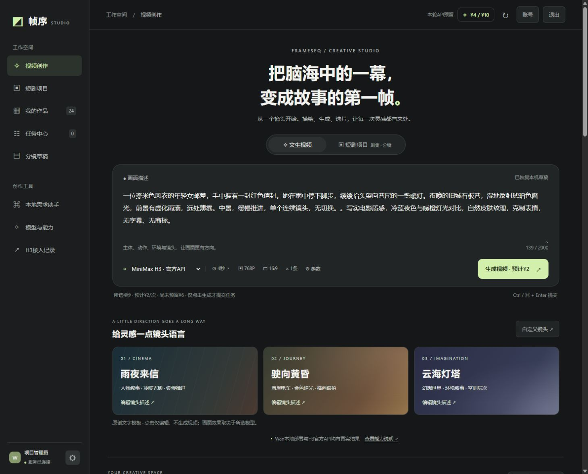
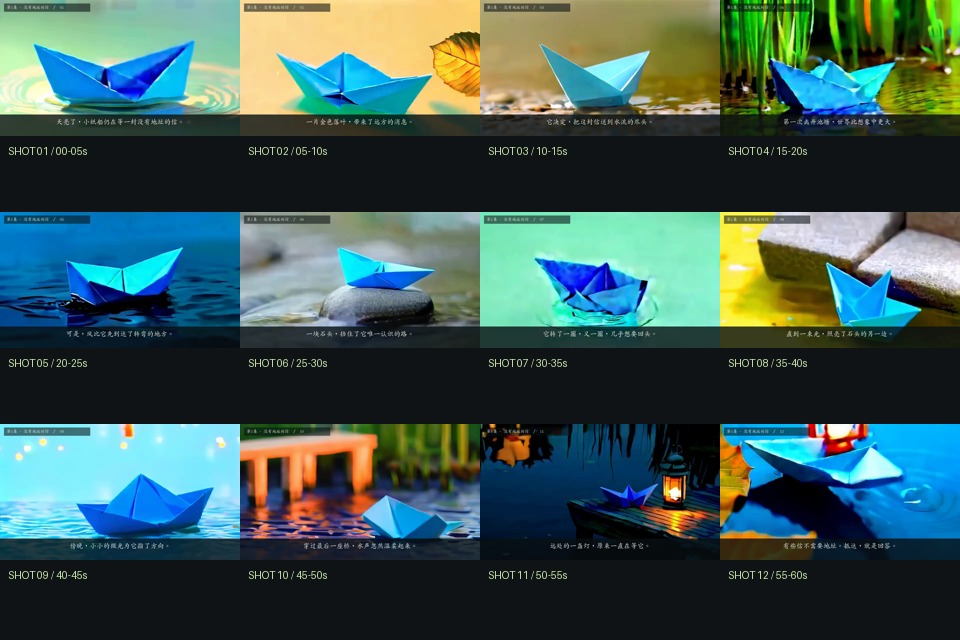

# 帧序 FrameSeq 视频生成与任务管理平台

使用 **Codex 辅助需求拆解、全栈开发、接口联调和排错**的个人实践项目：将视频模型封装成可提交、排队、追踪和下载的任务，并以项目、剧集和分镜组织生成素材。



## 先看真实成果

下载源码后，直接用浏览器打开 **[preview/index.html](preview/index.html)**，无需安装模型或填写 API Key。展示页播放已有真实视频，不提交生成请求、不连接作者的实验室。



《微光邮局》第一集由 **12 个真实 Wan2.1 镜头合成 60 秒**，包含中文字幕与程序合成配乐。源素材 480×272，输出 960×544 为普通缩放；没有 AI 人声，跨镜头外观和动作一致性有限。完整视频位于 `preview/assets/episode-demo.mp4`。

## 已实现与实际验证范围

| 模块 | 实现与证据边界 |
| --- | --- |
| 视频创作 | 描述、固定模型预设、提交、任务状态与历史、视频播放下载、参数复用和生成记录 |
| 本地推理 | 作者环境真实验证 Wan2.1-1.3B、CogVideoX-2B 及 MiniMax H3；Cog 为实验预览，存在已记录的画面失败案例 |
| H3 双卡 | 两张 TITAN RTX 24GB 共同采样同一条视频，接入现有 Turbo LoRA、8 步；真实输出 864×480、124 帧、24fps，约 5.17 秒 |
| 持久任务队列 | SQLite FIFO、独立 Worker、事务领取、资源锁、按账号隔离、限额、幂等和失败记录；一次执行一个本地视频任务 |
| 短剧与素材 | 项目—剧集—分镜、任务素材关联、人工选片、按选定素材剪辑导出、revision 冲突检查；素材不足拒绝导出 |
| 视频模型 API | 用户独立保存 MiniMax H3 / Seedance 2.5 / Wan 3.0 连接，AES-GCM 加密、独立 CPU worker、费用确认、下载验收；新三家适配器使用模拟供应商验证，未逐家提交真实付费视频 |
| 账号与后台 | 邀请注册、会话、CSRF、用户与结果隔离、用户管理、人工体验权益、模型开关、活动草稿与审计；未接入真实支付 |
| 片段编辑 | 记录区间和需求、用已有素材替换区间、导出新文件；AI 按提示词局部重拍尚未实现 |

历史 MiniMax 官方 API 真实生成与本地 H3 是两条独立链路。新个人视频 API 的模拟测试不作为三家模型真实生成成功的证据。源码保留早期本地 Qwen2.5-1.5B 需求助手原型：显式打开 `/assistant`、整理并确认后提交受限 Wan 任务；当前创作页不会自动用 Qwen 优化提示词，客户入口不提供该原型。外部语言助手 API 已移除。

## 实际技术栈

- 前端：原生 HTML / CSS / JavaScript ES Modules。
- 后端：Python、FastAPI、Pydantic、Uvicorn。
- 数据：SQLite（业务记录、账号与队列），自建独立 Worker，Linux `fcntl` 文件锁；未使用 Redis、Celery 或 Kubernetes。
- 推理与媒体：PyTorch、Diffusers、Transformers、ImageIO / FFmpeg；H3 使用独立的固定 ComfyUI 与社区兼容环境。
- 分发：Dockerfile / Compose 提供独立 CPU 审阅配置；包含 GitHub Actions CPU 检查配置。

详细设计与源码索引见 [架构说明](docs/ARCHITECTURE.md)、[接口约定](docs/API.md) 和 [验证记录](docs/VALIDATION.md)。

## 本机审阅

### 直接打开样例

双击 `preview/index.html`，可离线观看历史 H3 官方 API、Wan 本地及一分钟分镜合成作品。界面截图是历史实例记录，不是新实例的实时统计。

### Docker CPU 审阅配置

准备 Docker 与 Compose v2，在源码根目录运行：

```bash
docker compose up --build -d
docker compose ps
```

打开 `http://127.0.0.1:18081/review/` 查看样例，或 `http://127.0.0.1:18081/` 进入应用。初始账号 `operator`，随机密码只在自己的数据卷中查看：

```bash
docker compose exec app cat /var/lib/frameseq/.secrets/admin-bootstrap.json
```

CPU 审阅版可以体验账号、项目、分镜和后台；模型生成与视频导出关闭，不含原作者账号、密钥、数据库或实验室连接。Docker 构建和新主机尚未完成验收，不把配置存在写成镜像已验证。更多步骤见 [FRIEND_README.md](FRIEND_README.md) 与 [Docker 验证边界](docs/DOCKER_REVIEW.md)。

### Linux / WSL2 源码运行

后端依赖 Linux `fcntl`，不支持原生 Windows 后端。Python 3.10 / 3.11：

```bash
python3 -m venv .venv
source .venv/bin/activate
python -m pip install -r requirements-platform.txt
source scripts/env.sh
python -m scripts.bootstrap_accounts --enable --username operator
python -m uvicorn video_platform.api:app --host 127.0.0.1 --port 18080 --workers 1
```

本机打开 `http://127.0.0.1:18080/`。密码保存在本机 `.secrets/admin-bootstrap.json`。新实例为空，没有模型权重、推理环境、历史任务或原作者数据库。

## 模型与 API 部署边界

Wan / Cog 等推理依赖见 `requirements-inference.txt` 和 `scripts/download_models.py`。下载工具默认只显示官方文件与空间计划，只有显式 `--download` 才下载。权重下载不等于推理成功，使用前需自行核查许可证与可用硬件。

**H3 的独立 ComfyUI 环境、第三方推理 runner、模型权重及运行配置不在本仓库。** 平台的 H3 接口、任务调度与验证代码在仓库内；没有匹配环境和验收记录时明确不可用，不自动换成 Wan 或收费 API。尚不提供从全新机器一键部署 H3 的安装器。精度是混合存储与计算：DiT FP8 scaled 存储、文本编码器量化、主计算 FP16、音频 VAE FP32，不能表述为全精度未量化部署。详见 [H3 安装边界](docs/H3_AND_LANGUAGE_API.md) 与 [Turbo 记录](docs/H3_TURBO.md)。

个人视频 API 的配置、启用策略与独立 worker 步骤见 [VIDEO_API.md](docs/VIDEO_API.md)。默认关闭外部调用；保存 Key 不生成，提交时需要用户明确确认费用。禁止将 Key 写入前端、仓库或截图。

## 测试与可复查证据

在已安装 CPU 依赖的 Linux / WSL 环境执行；Node.js 20+，媒体测试需要中文字体：

```bash
source scripts/env.sh
python -m unittest discover -s tests -v
node --test tests/*.test.mjs
python -m scripts.audit_repository
```

已有记录包括：126 项公开副本 CPU 回归（138.624 秒）、后续视频 API 阶段 148 项 CPU 回归（146.884 秒）、工作空间阶段 28 项针对性后端与 26 项前端检查。这些是不同版本、相互重叠的历史测试，不相加为总覆盖率，也不表示当前 ZIP 重新执行过整套测试。GitHub Actions 尚未在托管环境验收。

32 次并发重试仅创建一条任务的证据来自**同账号、同提交标识的数据库队列测试**，不代表 32 路 HTTP 压测或 32 个视频同时推理。成片证据、失败记录和限制见 [VALIDATION.md](docs/VALIDATION.md)、[模型诊断](docs/MODEL_DIAGNOSTICS.md) 和 [最近 H3 真实验证](docs/H3_THERMAL_REPAIR_20261026.md)。

## 当前限制

- 这是单机邀请预览原型，不是生产级视频生成云服务；HTTP 接收并发不等于 GPU 生成吞吐。
- 双卡与 8 步已真实生成视频，但没有公平的单卡 / 双卡或 LoRA 单因素加速对照。最近记录含历史温控等待，不能据此推算关闭等待后的速度。
- 不含训练或自行微调的 LoRA、可靠角色一致性、AI 配音、AI 局部重拍、支付和生产内容治理。
- 历史受控重启与同机恢复已有测试；异机灾备、新主机 GPU 安装、生产压力与安全审计未完成。
- 仓库默认温控策略与作者实例可不同。实例策略不随源码发布；旧实验温度参数不能当作硬件建议。见 [配置说明](docs/APPLICATION_TEMPERATURE_POLICY_20261026.md)。

代码由开发者使用 Codex 辅助完成；模型和社区组件均独立署名。源代码采用 [MIT](LICENSE)，权重、第三方依赖与素材遵守各自条款，见 [NOTICE.md](NOTICE.md)。界面参考即梦的功能组织，没有复制其标志、源码或示例视频。

本次打包核对范围见 [2026年10月27日交付记录](docs/PUBLIC_RELEASE_20261027.md)。
