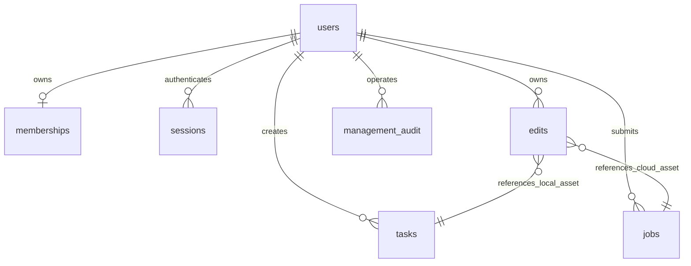

# 管理后台与片段编辑

## 这次实现的范围

`/admin` 是当前已登录管理员的运营后台，`/edits` 是每个账号自己的片段编辑空间。数据库已经存在于后端；这次增加的是持久化业务表、受权限保护的接口和可视化操作界面。浏览器关闭后数据仍保留，界面没有编造用户、会员或收入。

| 模块 | 已实现 | 明确边界 |
| --- | --- | --- |
| 数据概览 | 真实账号总数、正常账号、有效体验会员、任务状态、北京时间7日趋势 | 任务结构成功不等于视觉合格；各数据库分次读取，不是跨库同一时刻快照 |
| 用户管理 | 搜索、分页、账号启停；停用撤销会话 | 不删除作品、不终止正在运行任务；禁止从此入口停用管理员；不展示密码或会话 |
| 会员权益 | 人工开通、到期、撤销、备注、版本冲突保护 | 仅体验权益。本地每日20次，普通10次，最多同时2条。没有真实支付、订单、收入，付费会员显示0 |
| 模型服务 | 三个已接入模型的开关，API与受限助手提交都在队列写入前检查 | 不修改固定推理规格、密钥或预算，不自动下载模型；在途任务不受开关影响 |
| 活动公告 | 草稿、发布、归档、有效期、修订保护，首页展示有效已发布公告 | 纯文字，无链接执行、自动赠送、邮件群发或收款；演示活动保持草稿 |
| 管理审计 | 更改与审计在同一SQLite事务提交，分页查看 | 实例级记录，未接入外部不可篡改审计系统 |
| 片段编辑 | 选源片、选秒数、区间预览、保存需求、选已有素材替换、CPU导出、新版本播放下载 | 原片不覆盖。替换剪辑不执行提示词，不是AI局部重拍；输出重编码、切口连续性不保证 |

## 数据设计

沿用 SQLite。账号相关表在 `auth.sqlite3`：`users`（新增status）、`memberships`、`model_settings`、`campaigns`、`management_audit`；片段版本表 `edits` 在 `projects.sqlite3`。已有任务、云任务、项目和素材归属规则继续生效。SQLite备份覆盖这些数据库中的所有业务表。

图中素材关联是 `origin + task_id` 的逻辑引用，应用层检查归属与哈希；不同SQLite文件之间没有数据库外键约束。管理写入、修订检查和审计在同一账号库事务完成。会员有效期实时判断，过期自动恢复10次限额；不依赖前端倒计时。每日界限按北京时间。

当前是单实例邀请预览，没有因增加后台就称为可直接承载商业平台。若需要多实例和更大并发，再迁移PostgreSQL并引入专门任务执行和对象存储；当前未做此迁移、支付或公网压力测试。

## 即梦参考与模型能力

2026-10-21在已登录的[即梦首页](https://jimeng.jianying.com/ai-tool/home)实际查看：生成、资产、主体、画布、分镜技能、视频局部重拍、智能编辑、超清、提示词反推、3D导演台、图片多角度、动作捕捉、打光、全景图等入口。没有购买、提交重拍或复制其代码/素材。

对账号已有8秒素材，实际流程是：局部重拍→从资产选取→片段截取（本次界面要求4～8秒）→视频编辑，支持矩形/画笔/箭头/文字/标记与修改描述，显示208积分，未点击提交。该观察不代表任意模型、账号或时长均适用，也未验证即梦输出。

我们已经覆盖生成、历史、项目/剧集/分镜、版本、字幕剪辑、片段区间选择及后台管理。角色参考图、视频蒙版、画面局部重生成、超分辨率、提示词反推、3D/动作/打光/全景尚未接入；不能通过添加同名按钮来宣称支持。

[H3官方创建接口](https://platform.minimax.cn/docs/api-reference/video-generation-v2-create)（2026-10-21查阅）支持text与图像、视频、音频参考组合。视频参考有2～15秒、帧率23.976～60等约束；官方页面没有指定时间蒙版或选区外逐帧不变的契约。现有H3适配器仍只有文生视频，不能把该文档能力直接记为本站已实现。Wan/Cog当前适配器也是文生视频，未实现时间或空间蒙版推理。

下一步真正AI重拍需要：接通适合的编辑模型/端点、受权限保护的输入素材传递、参考输入计费核查、边界帧与音轨策略、显式预算确认、真实输出对照。此前10元预算不自动扩大；本次新增付费生成0次。

## 开源后端参考

参考 [New API](https://github.com/QuantumNous/new-api) 的[用户模型](https://github.com/QuantumNous/new-api/blob/main/model/user.go)、[订阅模型](https://github.com/QuantumNous/new-api/blob/main/model/subscription.go)、[异步任务模型](https://github.com/QuantumNous/new-api/blob/main/model/task.go)：区分用户状态与角色、权益有效期与支付订单、内部上游信息与对用户返回的字段。它是包含视频异步任务的AI网关，不是现成短剧编辑器；本项目未部署或复制其实现，保持自己的FastAPI/SQLite代码。其仓库许可证为AGPL-3.0，不能把源码当作无条件可拷贝的MIT依赖。

也查看了 [AIGCPanel](https://github.com/modstart-lib/aigcpanel)，它提供视频/声音合成与本地模型管理，仓库为Apache-2.0；其Electron桌面产品形态与我们多账号Web平台不同，未把它称为已经接入的会员后台。

## 实际验收

- 隔离实例80项CPU后端检查通过105.439秒，包括6项管理与4项片段测试；合成测试片清楚标注非AI生成。16项前端规则通过。非全新依赖安装或已执行的GitHub托管CI。
- 实际管理员界面读取2账号、33生成任务；搜索用户名、创建活动草稿、审计回读已验证。会员启停、停用撤会话、模型拒绝、跨账号拒绝、过期和冲突均用隔离HTTP/SQLite测试，不在真实用户账号上制造操作。
- 实际编辑 `7e82ffed70d74c768ce0f402fbd781b3`：已有H3雨夜片第1～3秒替换为已有Wan雨夜素材。107帧/24fps/1344×768/4.458333秒，替换帧区间[24,72)，48帧，CPU耗时6.085秒。SHA256 `6c471637dd0dc89fda9a803d504d13decf0f6356141f366413dfb31967f1646f`。不把它当作AI重拍或角色一致性合格成片。
- 真实HTTP Range206、完整下载哈希、原片哈希不变，浏览器播放到4.458333秒结束、readyState4。源片对照帧0/23/72/106平均绝对像素差约1.42～1.81（重编码差异）；替换区间24/48/71差约30.08～30.95。证明指定区间发生替换，不宣称无损或像素完全不变。
- 本次不占用GPU、不新下载权重、不提交付费模型任务。原预算预留4/10元，实际账单仍未核对。

## 接口入口

管理员：`GET /api/admin/overview`、`GET /api/admin/users?q=&offset=`、`PATCH /api/admin/users/{id}/status`、`PUT /api/admin/users/{id}/membership`、`GET/PUT /api/admin/models[/id]`、`GET/POST/PUT /api/admin/campaigns[/id]`、`GET /api/admin/audit`。用户、模型、活动更新使用结构化字段；会员/模型/活动写入带revision。全部管理员接口要求真实登录的admin身份，写入还需同源CSRF。

片段：`GET /api/edits/capabilities`、`GET/POST /api/edits`、`GET /api/edits/{id}`、`GET /api/edits/{id}/video`。POST需Idempotency-Key，同键不同内容拒绝；源片与替换素材都须属于自己并校验哈希。draft只落库不执行；replace启动有限CPU剪辑进程。当前只支持16秒内、1920×1080以内素材；不拉伸时长、不循环补帧。进程硬中断可能留下running，需排查后另建版本，尚未实现独立CPU剪辑任务的自动故障恢复。
