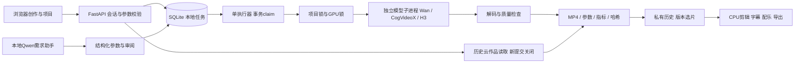
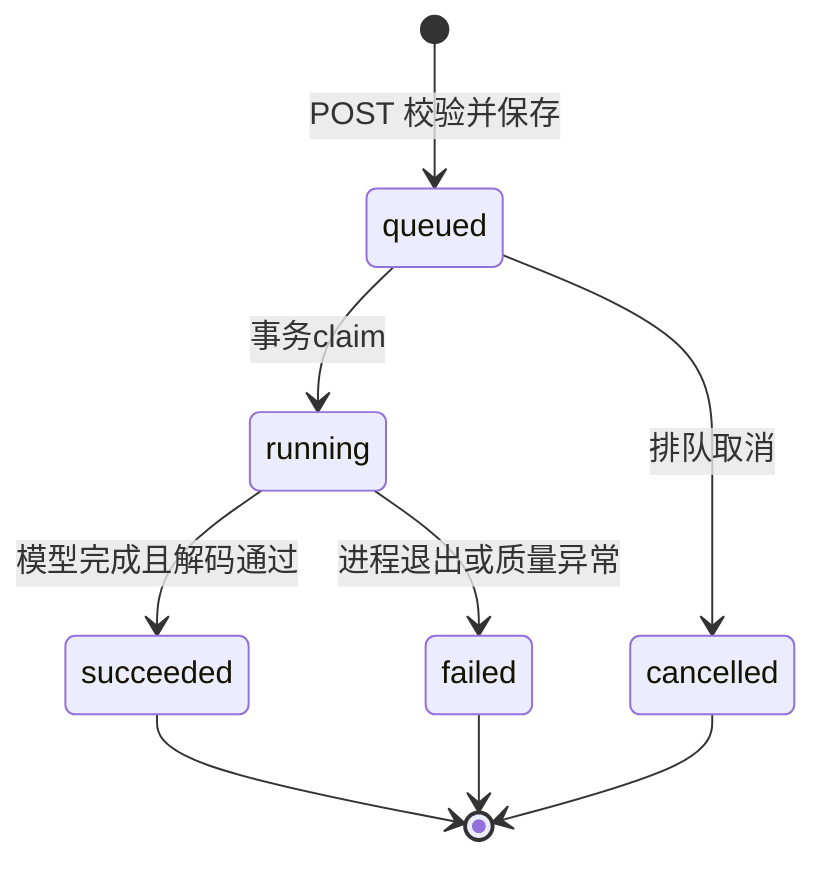

# 请求如何变成视频

## 为什么这样拆

API进程只做校验、持久化和读取，模型放独立进程，避免HTTP请求占用GPU直到完成。页面轮询真实状态；采样进度与云任务等待分开，不编造百分比。采用原生ES模块保持第一版依赖简单，演示重点是服务与任务正确性，而非框架数量。

`config.py`统一定位工程目录，默认当前checkout，可用`VIDEO_PLATFORM_ROOT`覆盖。模型、日志、临时文件、凭据和数据库保存在实例目录，源码仓库不携带实际实例数据。

## 本地任务状态

`store.py`用短事务和`BEGIN IMMEDIATE`协调抢占；两个并发claim只有一个取得运行资格。幂等标识与参数比较使重复点击返回同一任务，不同参数复用相同标识返回冲突。普通账号最多2个未完成本地任务、每日10次提交，全局10个未完成任务。

`worker.py`是一个持久协调器。重启时根据本账号、模块命令和稳定job ID查找已有模型进程并重连，不把已运行任务重新排队。模型子进程退出后再验收/启动下一项，避免CUDA释放时重叠。项目锁、GPU锁与占用检查分别防止本项目重复采样及误占别人的设备；检查不是对共享GPU的永久资源预约。

H3采样用两张允许且实时空闲的GPU共同生成同一条视频；编码/解码用其中一张卡。持有全局锁和两卡锁，维护模式拒绝新生成。完整采样结果可供解码重试；采样中途暂停没有步间checkpoint，需要重新采样，不能宣称无损续跑。实际硬件与温控耗时见[H3实验边界](H3_AND_LANGUAGE_API.md)。

没有实现多机心跳、跨节点租约、优先级、抢占式调度或自动GPU扩缩容。SQLite+文件锁属于单机持久队列，不能称为K8s调度平台。

`model_profiles.py`为CogVideoX固定已验收的模型参数与配置版本。API把版本、步数、调度器、计算/VAE精度写进任务；worker声明支持版本并核对字段，然后明确传给模型子进程，不能受全局精度默认值影响。缺少对应版本证据、执行器过旧或参数漂移时拒绝提交/执行。普通HTTP请求不能自行覆盖这些内部字段。历史失败记录不按新配置悄悄重跑。

## 云API为何另有一条链路

`cloud.py`保留历史官方任务ID、预算预留与不重复收费的实现。当前HTTP新提交、重试和查询恢复均关闭，历史作品仍可读取。旧实现将不明确的POST记为`unknown`，预算用整数分事务预留；这些是历史能力，不表示现网仍启用收费生成。

## 项目、权限与输出

`projects.py`保存稳定镜头ID和生成时的参数快照；修改描述不会覆盖旧版本。revision乐观锁拒绝冲突覆盖。`composition.py`只裁取已选且足够长的成功素材，不靠静帧凑时长；保留输入/输出哈希和SRT时间。

`auth.py`使用PBKDF2随机盐、服务端会话、HttpOnly/SameSite Cookie、同源CSRF和账号隔离。`ownership.py`把身份传到数据层；客户端传入别人的ID不能绕过owner过滤。仅一份经操作者批准的原创示例允许匿名访问，不能任意指定公开文件路径。

## 关键入口

| 看什么 | 文件 |
| --- | --- |
| 参数校验、HTTP状态与路由 | `video_platform/api.py` |
| 队列、幂等、容量与持久状态 | `video_platform/store.py` |
| 执行与崩溃重连 | `video_platform/worker.py` |
| 真模型加载、CPU编码、单卡推理 | `inference.py`、`cogvideo.py` |
| H3三阶段执行、双卡资源交接 | `h3_local.py`、`h3_runtime.py`（推理runner另配） |
| 预算与供应商错误边界 | `cloud.py` |
| 有界工具调用 | `agent.py` |
| 项目版本、选片与成片 | `projects.py`、`composition.py` |
| UI规则与测试 | `web/studio-state.mjs`、`tests/studio-state.test.mjs` |
