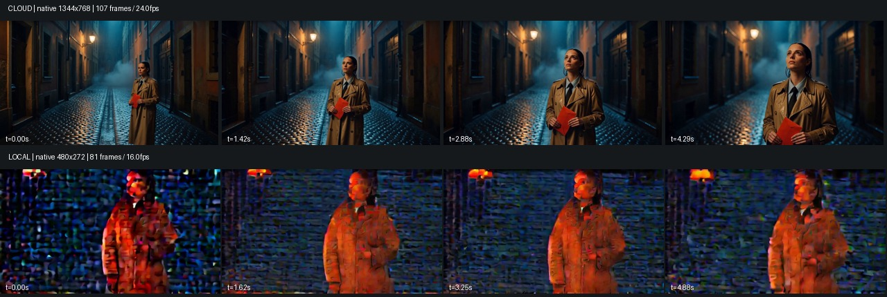

# 从流程样例到叙事镜头

2026年10月21日实际查看即梦首页《致我们的世纪青春》及其只读创作过程。视频显示2分51秒，画布含角色参考图、多个图片/视频节点及多版本资源；不是一条短提示词一次生成整部成片的证据。未复制其作品、品牌或提示词，未调用即梦付费生成。

参考：[作品及只读创作过程入口](https://jimeng.jianying.com/ai-tool/work-detail/7695003820446911769)。本项目独立实现分层字号、深浅主题、集中参数、原创镜头模板与五项可编辑镜头描述；文字工具不冒称AI改写，带入描述不提交生成，草稿按账号保存在浏览器。

## 实际同场景对照：雨夜来信

原创内容为穿米色风衣的女邮差，手持红信封，在雨夜石板巷抬头望向暖灯，镜头缓慢推进。中文用于H3、同语义英文用于Wan；分辨率、时长、模型不同，不作为严格控制变量的模型排行榜。

| 项目 | H3官方API | 本地Wan1.3B |
| --- | --- | --- |
| 输出 | 1344×768 / 107帧 / 24fps / 4.458秒 | 480×272 / 81帧 / 16fps / 5.06秒 |
| 用时 | 提交到验收103.513秒 | 推理357.333秒，包含降温 |
| 视觉观察 | 人物、信封、湿地光影、抬头和缓慢推进可辨认 | 明显彩色噪声，人物细节差，已拒绝作为作品 |
| 费用 | 新预留2元，总预留4/10元；实际账单未核对 | 未调用收费API |

H3完整解码、Range206、下载SHA及浏览器播放到结尾通过。SHA256：7e0752bd7b7471c948be42150b482ddd054ff1e9a01e23ec4bdec3fc563e0d87。同一条低分辨率Wan即使结构校验通过也不代表画质合格，保留原文件和失败标记，不能选片导出。

## 查明与尚待验证

- 真实分词长度136，旧API上限128，存在静默截断。API现明确记录512上下文，编码前拒绝超限描述与负面描述；增加边界回归。该修复不等于证明截断导致像素噪声。
- FP16→FP32单变量对照已完成，保持原种子、描述、步数、分辨率与128上下文，1725.208秒含降温。仍为相同块状彩噪，助手视觉拒绝；不能把改精度当成解决方案。
- 当前低分辨率配置偏重链路验证；官方Wan1.3B建议480P。原生832×480与512上下文的这条人物视频已实测，结果见下文；没有通过普通放大冒充原生清晰度。
- 尚无人物参考图管线、跨镜角色锁定或AI配音。长片还需要分镜、参考素材、选片与后期。此次H3是一条叙事镜头，不冒称整集完成。

## 验证

本轮70项CPU后端、15项前端规则通过；实际浏览器检查16px描述输入、深浅主题、390px视口无页面横向溢出、编辑/带入/草稿恢复，控制台无错误。手机测试是浏览器视口模拟，不是实体手机。GitHub托管CI未实际运行，未公开部署。

原生480P实验已通过真实HTTP队列：固定832×480/81帧/40步/512上下文/FP16计算与FP32解码，1232.356秒含降温，峰值5,253,911,552字节。块状彩噪消失，可辨认人物、巷道及光影；红信封变为黄色包裹，动作与运镜服从有限。通过实验预览，非完整语义合格。改变分辨率与上下文两个变量，不能据此归因某个单一根因；不代表所有提示词或硬件都通过。

原生任务重复提交同ID、完整解码、下载SHA、Range206及浏览器播放到5.0625秒结尾通过。SHA256：c5c313a2a5abb8fac39870a6a84ddf95db0d8e6439a14df25ada818fa6e7bc63。前端在验收前禁用该规格，验证标记与完整参数契约一致后才解锁；执行器配置漂移拒绝。复用能保留原生规格，项目分镜也可选。见[参数与质量限制](examples/wan-native480-record.json)。

另修正首次会话请求因断网失败后永久卡住的问题：自动重试网络/HTTP/响应格式失败，未确认会话前不假定匿名身份；延迟启动时保留输入。模拟故障单测通过，真实断线后恢复SSH转发、登录和草稿的浏览器检查通过；没有把后者写成自动重连的完整故障注入验收。

41个公开Python文件格式化前后AST相同；新独立源码副本70项CPU回归、空实例初始化/登录/退出/私有接口401与模型未配置检查通过。复用既有Python依赖，未验证异机fresh install，GitHub Actions尚未运行。此前ZIP与私有检查点保留，后续新档另行编号。
