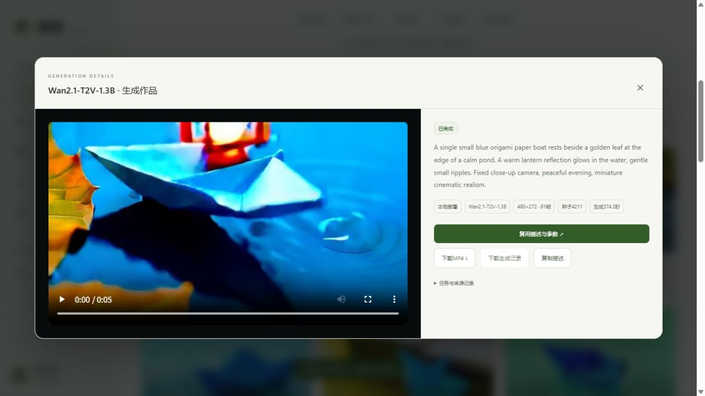

# 用五分钟说明项目

1. 先播放真实示例，指出12个不同镜头、字幕、来源尺寸和一致性限制。不要说是模型单次直接生成一分钟。
2. 建项目、建剧集、加两个镜头，说明保存只是数据库操作，没有提交生成或产生云费用。
3. 从一个镜头带入创作，选模型与规格，说明Wan单卡与H3双卡同视频的区别；旧H3官方API样例保留历史来源，新云提交已关闭。真实生成较慢时展示已有任务记录，不冒充即时完成。
4. 看排队、状态、失败原因、视频与参数；点击复用只恢复表单。说明幂等如何避免连点造成重复工作。
5. 看两个历史版本，采用一版，再导出；素材不足时展示明确拒绝，说明输入输出哈希和SRT记录。

## 开发者应亲自回答

- 页面点击一次生成之后，分别是谁创建记录、claim任务、选择GPU、启动模型、验收MP4？
- 为什么两个请求同时claim只有一个成功？为什么重复点击不会重复生成？
- worker崩溃而模型进程还在时如何恢复？本项目是单机队列，和分布式调度差在哪里？
- H3为什么两卡还需近49分钟？前向/通信与降温分别花多久？为什么没有公平单卡对照就不能说提速两倍？
- 双卡采样与单卡编码/解码如何交接？为什么采样中断没有checkpoint，完整采样后却可以只重做解码？
- 供应商POST超时为什么不能直接重试？已知任务ID与未知任务ID如何区别？
- 为什么账号隔离必须放在数据查询里，而不是只隐藏前端按钮？
- 为什么TITAN RTX不能照抄BF16示例？FP16/FP32切换能解决什么、不能保证什么？
- 为什么不用Redis/K8s/微服务？什么规模或瓶颈出现后才值得引入？
- 助手只生成JSON有什么不足？工具白名单、审阅、幂等是怎样限制影响的？
- 自带密钥文案助手为什么固定供应商地址、不持久化Key、不自动重试？哪些提供商只做了模拟验证？

AI辅助实现不等于已经掌握。建议本人亲自改一次参数校验、加一个边界测试、阅读一次失败日志并沿代码解释修复，再把相应能力写进简历。

## GitHub发布前

当前目录是独立源代码发布目录。实验室的源工作区、私有备份ZIP和整个聊天项目目录都不应直接上传。提交前运行`python -m scripts.audit_repository --tracked`并检查`git diff --cached`。

新仓库没有原实例账号、权重和日志；不要为展示方便发布管理员密码或供应商密钥。GitHub Actions文件需要推送之后才会真实执行，不提前放通过徽章。托管GitHub仓库与将平台对公网提供服务是两件事。

## 可核对的生成记录

真实作品详情可以下载JSON记录，包含描述、种子、尺寸、帧数、耗时与输出SHA256，导出不会重新调用模型。示例记录来自同一真实Wan分镜：[查看JSON](examples/wan-shot-record.json)。记录不含服务器地址、认证信息或供应商签名下载链接。

CogVideoX实验预览也已实际走通HTTP→队列→执行器→播放下载，并保存相同配置版本；[下载记录](examples/cogvideo-preview-record.json)可核对20步、DPM、FP16与结果哈希。演示时同时说明原短描述曾白屏、当前构图和细节仍有限，不把局部样例说成通用质量通过。
