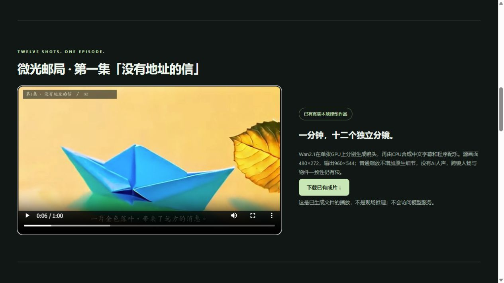

# Docker CPU审阅包

2026-10-22新增，入口为scripts.container_review，独立于原有模型API启动入口。朋友说明见[FRIEND_README.md](../FRIEND_README.md)。

## 运行结构

- Dockerfile使用Python3.11 slim-bookworm、requirements-platform.txt、FFmpeg与中文字体，不安装PyTorch或模型依赖。
- Compose将容器18080绑定至宿主机127.0.0.1:18081，使用独立命名数据卷，普通UID10001、只读镜像、无新增权限、无Docker socket。
- 初始化生成本机随机管理员及邀请登录配置；再次启动保留密码和用户数据，拒绝把已有非审阅数据库改成审阅卷。
- 包装应用把/review静态自有素材与原FastAPI应用组合，显式调用被挂载应用的启动生命周期，健康检查会实际读取队列数据库。
- 服务端阻断所有本地生成、云生成/重试/恢复、模型助手与导出入口，不启动worker或收费请求。保存项目、剧集、分镜和账号管理仍使用真实数据库。HTML页面标注CPU审阅版。
- 镜像构建上下文使用拒绝默认的白名单，Dockerfile也显式复制所需目录。打包排除私有数据与Git元数据，按清单重新验证每个文件的SHA256。
- 预生成MP4保持原字节：H3约4.46秒、Wan约5.06秒、《微光邮局》60秒。成片27,743,489字节，SHA256为a9300d0c468e819d3675b670e49877f540a3eb9eae6fcbf7a13aa20a81b3f3e4。仓库大文件审计只为这一精确路径/大小/哈希放行，不泛化到所有视频。

## 验收状态

独立Linux副本已完成：87项CPU后端测试通过（113.467秒），包含6项审阅入口测试与1项大媒体防篡改测试；16项Node前端规则通过。另用真实运行的HTTP实例验证登录、创作页/后台、匿名越权拒绝、生成硬性拦截、空队列保持，以及3条真实样例的Range206/字节匹配。Compose YAML解析与指定安全约束检查通过，未使用docker compose CLI。报告见docs/examples/docker-review-report.json。

原始SSH脚本在87项测试全部OK后，因管道追加CR空行返回1；这是脚本传输问题，不能将整条shell命令写成exit0。后续Python HTTP验收进程独立返回0，未重启原平台。专用SSH密钥不允许新增端口转发，未修改该限制；展示页在本机回环HTTP验证。

本机未安装Docker，实验室账号没有Docker daemon权限。因此不能宣称docker build、compose up或镜像跨机运行已经通过。应用在独立Linux目录复用现有Python依赖的验收，也不等于容器构建或全新依赖安装。Docker Compose配置遵循[官方入门](https://docs.docker.com/compose/gettingstarted/)与[构建上下文规则](https://docs.docker.com/build/concepts/context/#dockerignore-files)。

这是朋友本机审阅分发方式，尚不代表GPU模型容器化、生产部署、高并发、公网发布或K8s能力。基础镜像使用可移动版本标签，依赖仍有范围约束；正式部署需固定镜像digest和完整依赖锁文件，并在目标Docker环境构建验收。

## 实际浏览器检查

在本机回环静态HTTP打开展示页，H3播放至4.458333秒结束、Wan播放至5.0625秒结束；一分钟成片元数据60秒、960×544，已实际播放后暂停在6.568秒。切换模型与架构按钮正常，所查浏览器控制台无error。直接file方式未单独做浏览器自动化验收。

